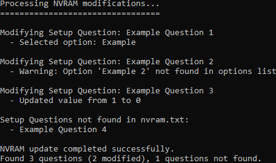

# AutoSCEWIN
Tool to automate [SCEWIN](https://github.com/ab3lkaizen/SCEHUB)



## Usage
Parses `input.txt`, must be formatted as the following:

`Setup Question | Option`

`Setup Question - Option`

Option can be either numerical value or text

Place `AutoSCEWIN.exe` in the same directory as `input.txt` and `nvram.txt`

Run with `--ignore-case` for `input.txt` to be parsed as case-insensitive

Supports modifying the following:

```
Options	=*[00]Example
         [01]Example2

//

Value	=<0>

//

Value	=0
```

## Build
`g++ -std=c++17 -O2 -static -o AutoSCEWIN.exe AutoSCEWIN.cpp`
